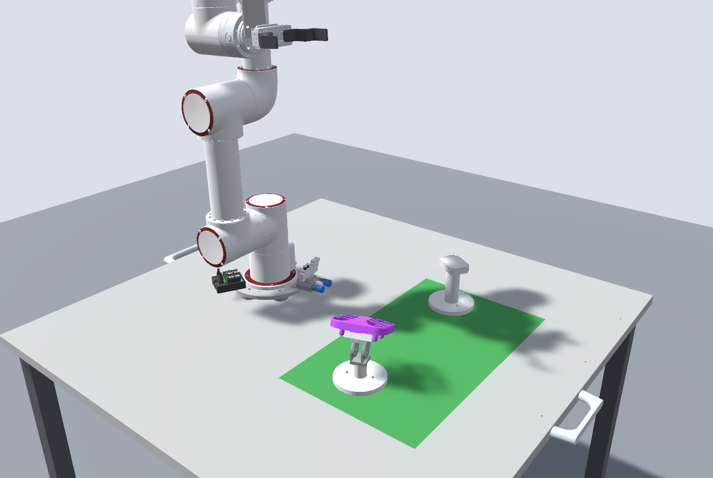
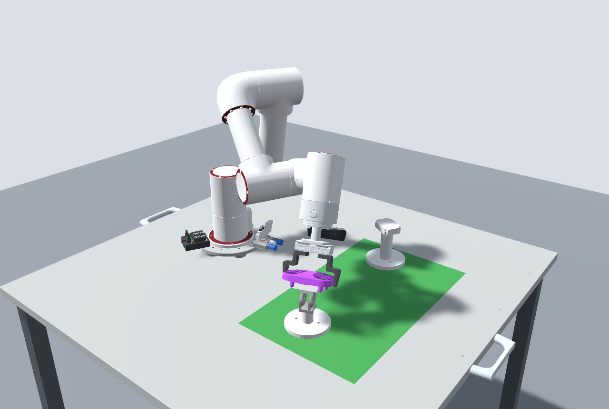
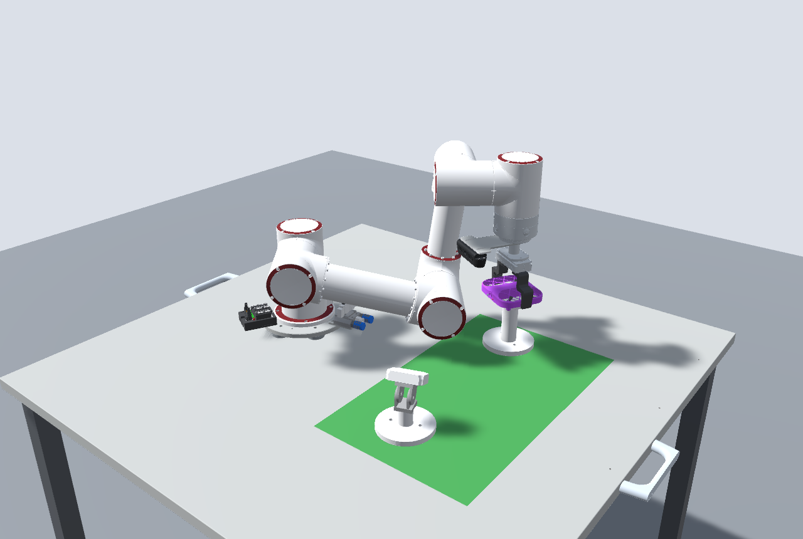
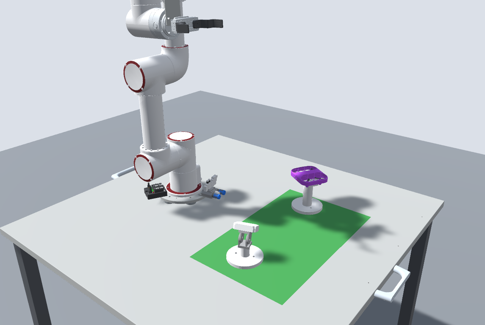

# Lab4 基于 STEP 模型的 Unity 3D 虚拟仿真：无人机自动抓放

用课程提供的 STEP 装配模型（6 轴协作机器人 + 气动夹爪 + 四轴无人机 + 立柱支撑架 + 角度可调斜面支撑架）搭建 Unity 场景，
所有设备调整与运动均由程序控制：支撑架位置/朝向/倾角、机器人各关节、夹爪开合，以及“抓取 → 搬运 → 放置”的自动流程。

| 起始布置 | 夹取无人机 | 搬运到立柱支撑架 | 放置完成 |
|---|---|---|---|
|  |  |  |  |

## 运行

1. 安装 **Unity 6.3 LTS（6000.3.28f1）**，用 Unity Hub 打开 `DroneSim` 文件夹。
2. 首次打开会根据 `DroneSim/ModelData` 自动生成网格、材质和场景 `Assets/Scenes/Lab4.unity`
   （也可用菜单 **Lab4 / 生成仿真场景** 手动重建）。
3. 点 ▶ 运行，在 Game 视图左侧的控制面板中操作：

| 标签页 | 功能 |
|---|---|
| 自定场景 | 输入两个支撑架的 X/Z（mm，桌面中心为原点）、朝向角、斜面倾角及搬运方向 → “应用布置” → “执行抓放” |
| 教师指定场景 | 同上，用于现场输入教师给定参数（默认值为 CAD 原始布置） |
| 手动控制 | 滑条控制 J1–J6 关节、夹爪开合，实时调整支撑架朝向与倾角 |

视角：右键拖动旋转、中键平移、滚轮缩放；F1 全景 / F2 机器人 / F3 支撑架 / F4 跟随夹爪；Tab 隐藏面板。
机器人底座位于 (X=0, Z=-220)，支撑架距底座 0.3–0.5 m、倾角不超过约 25° 时最稳定。

## 目录结构

```
DroneSim/                     Unity 工程
  Assets/Scripts/Runtime/
    RobotArm.cs               关节控制、正运动学（指数积 POE）、数值逆运动学（阻尼最小二乘，多初值求多解）
    Gripper.cs                气动平行夹爪：开合、接触即停、夹持（挂到 TCP 下随动）
    Graspable.cs              无人机：抓取点、两种等价抓取朝向、落座到托盘
    SupportStand.cs           支撑架：位置/朝向，斜面支撑架绕铰链倾斜
    PathPlanner.cs            带碰撞检查的路径规划（直线段、关节转移、RRT-Connect），分帧执行
    CollisionMonitor.cs       凸包分块碰撞检测（机器人自碰撞、与桌面/支撑架/无人机）
    PickPlaceTask.cs          自动抓放流程
    ControlPanel.cs           运行时控制面板（IMGUI）
    OrbitCamera.cs            环绕相机、预设视角、画质设置
  Assets/Scripts/Editor/
    SceneBuilder.cs           由 ModelData 生成网格、材质、运动层级与全部组件
    Verify.cs                 批处理验证、可达范围扫描、性能剖析（菜单 Lab4/…）
    OpenLab4Scene.cs          打开工程时自动生成/打开场景
  ModelData/
    meshes/*.obj              各零件网格（Unity 坐标：米、Y 向上、左手系）
    scene_unity.json          关节轴、TCP、托盘坐标系、铰链等测量数据
tools/                        STEP → Unity 转换脚本（Python + OCP/OpenCascade）
docs/images/                  截图
```

## 实现要点

**STEP 转换**（`tools/`）：用 OCP（OpenCascade）读取 STEP 装配树，逐零件三角化并保留颜色，坐标换算到 Unity
（mm→m，Z 向下→Y 向上，右手→左手系并翻转三角形绕序）。关节轴不依赖厂商参数，而是从 CAD 几何中测得：
相邻连杆共有的同轴圆柱面即关节轴；铰链轴取自销钉圆柱；托盘坐标系取自安装孔。
由此确定机器人为 J2/J3/J4 平行的 6 轴构型，夹爪中心（TCP）位于 J6 轴上。

**运动学**：CAD 姿态作为零位，正运动学采用指数积公式；逆运动学为数值阻尼最小二乘，
从多组典型构型初值出发得到多组解（肘上/肘下、手腕翻转），供规划器挑选。

**抓取几何**：两指垫张开间距 113.4 mm，无人机夹持宽度 106 mm；夹爪沿托盘法线自上而下接近，
抓取与放置位姿都由托盘坐标系推出，因此支撑架任意摆放/倾斜时程序无需修改。

**无碰撞路径规划**：
- 运动分段：升到安全高度 → 高处转移 → 竖直下降到预位姿 → 沿托盘法线直线接近；退出与回零位同理。
- 每段先在虚拟状态下逐点做碰撞检查（零件按 k 均值拆块后求凸包，减少弯曲连杆的假阳性），整段无碰撞才执行；
  选抓取构型时连同“夹着无人机退出”一起检查。
- 关节转移依次尝试：直接插补 → 先调手臂后转底座 → 先转底座后调手臂 → 收拢到竖直姿态再展开 → RRT-Connect 随机搜索。
- 规划分帧执行（每帧 ≤ 8 ms），让出帧前恢复真实姿态，画面不卡顿、不闪烁。
- 找不到无碰撞路径时机器人不动作，状态栏提示调整支撑架。

## 验证结果

菜单 **Lab4 / 批处理验证** 在编辑器中逐帧推进完整流程并逐帧做碰撞检测：

- 自定场景、教师默认场景：成功，全程无穿模，放置误差 < 0.3 mm。
- 随机布置 60 组（位置、朝向、倾角 ±35° 随机）：35 组成功且全部无穿模；
  失败的约 14 组超出机械臂工作空间（距底座 > 0.55 m，或倾角较大且背离机器人），
  其余为离底座过近时竖直下降经过奇异位形或手臂折叠碰撞，状态栏会给出具体原因。
- 规划耗时：每次 < 1 s，单帧最长约 30 ms。

## 从 STEP 重新生成模型数据（可选）

```bash
python -m venv tools/venv && tools/venv/Scripts/pip install cadquery-ocp numpy vtk
tools/venv/Scripts/python tools/export_parts.py model/model.step model/obj
tools/venv/Scripts/python tools/convert_for_unity.py model/obj DroneSim/ModelData
```

`analyze_step.py` 打印装配树，`render.py` 离屏渲染零件预览，用于核对几何。
